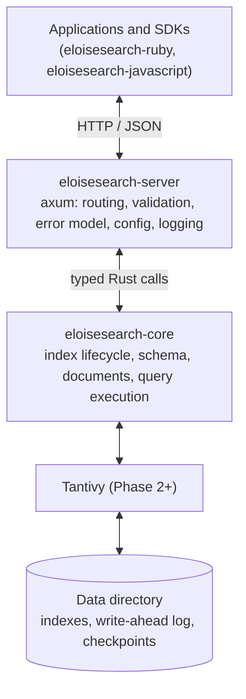

# eloisesearch — Architecture

> The operational map: what the code is, how a request flows, and where things
> live. Why it is shaped this way is in [`design-decisions.md`](design-decisions.md);
> what the API promises is in [`api-contract.md`](api-contract.md).

## Purpose

Give an application full-text search (weighted fields, phrases, exclusions,
filters, facets, suggestions, highlighting, pagination) from a single process
with a local data directory and a versioned HTTP/JSON API. The first use case
it must serve end to end is a movie-search app with a Rails API and a Nuxt
frontend.

## Shape

Single node. No clustering, sharding or replication in the MVP.

## Crates

| Crate | Responsibility | Must not |
| --- | --- | --- |
| `eloisesearch-core` | Domain types (`IndexName`, …), errors, and from Phase 2 the index lifecycle, schema, document store and query execution. | Depend on axum, tokio, HTTP types or the server. Expose Tantivy types. |
| `eloisesearch-server` | `Config` from `ELOISESEARCH_*`, tracing setup, the axum `Router`, `ApiError`, graceful shutdown. `lib.rs` holds everything testable; `main.rs` only wires config → tracing → `run`. | Contain search logic. Handlers parse, call the core, map the result. |

## Request flow

1. `TraceLayer` opens a span per request; `TimeoutLayer` aborts requests that
   exceed `ELOISESEARCH_REQUEST_TIMEOUT_SECS` with 408.
2. The router matches the route. Unknown paths go to the `not_found` fallback,
   known paths with the wrong method to `method_not_allowed`. Both return
   `ApiError`.
3. A handler parses input into typed values, calls the core and returns JSON.
4. Core errors convert into `ApiError` through `From<eloisesearch_core::Error>`:
   validation errors become 400 with a specific `type`; anything unexpected is
   logged and returned as a generic 500 without internal details.

## Startup and shutdown

`main` reads `Config::from_env()`; an invalid value prints the variable, the
value and the reason, then exits with code 2. `run` creates the data directory,
binds the listener and serves until Ctrl+C or SIGTERM, then drains in-flight
connections before exiting.

## Where things live

| Path | What |
| --- | --- |
| `crates/eloisesearch-core/src/index_name.rs` | Index name rules; names become directory names. |
| `crates/eloisesearch-core/src/error.rs` | Core error enum (`#[non_exhaustive]`). |
| `crates/eloisesearch-server/src/config.rs` | Environment parsing; `from_lookup` is the test seam. |
| `crates/eloisesearch-server/src/error.rs` | `ApiError` and the JSON error body. |
| `crates/eloisesearch-server/src/routes.rs` | Router, middleware stack, handlers. |
| `crates/eloisesearch-server/tests/http.rs` | In-process HTTP tests (no socket). |

## Cross-cutting invariants

The list is maintained in [`AGENTS.md`](../AGENTS.md#cross-cutting-invariants-do-not-violate).
When you add one, add the test that fails if it is broken and reference it there.

## Testing strategy

- **Core unit tests**: pure, no I/O except temp directories.
- **Server HTTP tests**: drive `routes::router` with `tower::ServiceExt::oneshot`;
  no ports, no network.
- **Contract tests** (Phase 3): the behavioral fixtures from
  `eloisesearch-integration` run against a live server.

See [`quality-plan.md`](quality-plan.md) for relevance evaluation and benchmarks.
